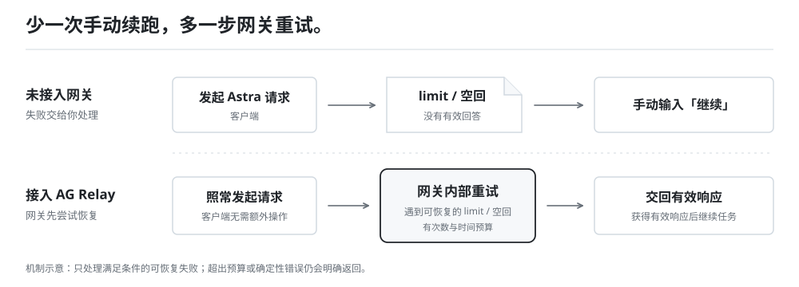
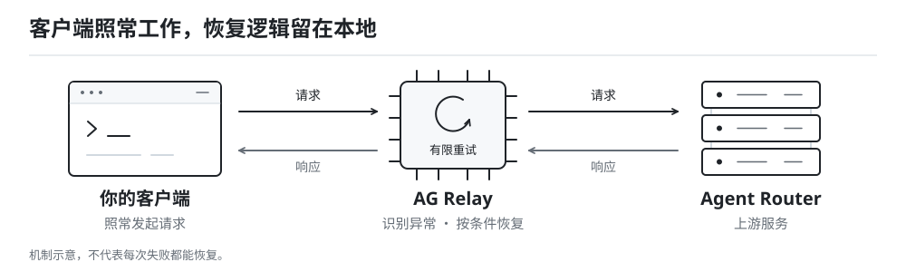

<p align="center">
  
</p>

<h3 align="center">Astra 高峰 PVP，不必再拼手速。</h3>

<p align="center">
  专为 Agent Router 优化的本地重试网关。<br>
  遇到可恢复的 limit 或空回，秒级接续尝试，少一次手动「继续」。
</p>

<p align="center">
  <code>Windows x64</code> · <code>本地运行</code> · <a href="LICENSE"><code>开源 MIT</code></a>
</p>

<p align="center">
  <a href="https://github.com/xinxinxiaoxin/ag-relay/releases"><strong>下载 Windows 版</strong></a> ·
  <a href="#快速开始">快速开始</a> ·
  <a href="#它具体处理哪些报错">支持处理的报错</a> ·
  <a href="https://github.com/xinxinxiaoxin/ag-relay/issues">反馈问题</a>
</p>

## 高峰期难等，就别再慢在手动重试上。

Astra 的高峰「PVP」，消耗的不只是等待时间：一次 `limit`，一次空回，任务又停在那里。你看到报错、切回窗口、补上一句「继续」，才开始下一轮尝试。

**把这段反复操作，留给 AG Relay。** 识别到可恢复失败后，网关在内部按秒级间隔自动重试，不必等你亲自回来重发。拿到有效响应，再交给客户端，让当前任务尽量接着跑。

AG Relay 致力于把所有可消化的错误留在网关内部处理，加速获得上游资源。

**我们的目标：永不报错，永不「继续」！**

<p align="center">
  
</p>

## 它具体处理哪些报错？

重点是限流与空回：能重试的先在网关里处理，不能恢复的明确返回，而不是让你一直猜。

| 你遇到的问题 | AG Relay 会怎么做 |
| --- | --- |
| **限流、过载与连接抖动**<br>429 / 408 / 可恢复的 5xx | 使用新连接，在次数与时间预算内按策略重试；识别到确定性错误时停止无效尝试。 |
| **返回 200，内容却是错误**<br>JSON 错误体 / 流内早期错误 | 继续检查响应内容，识别被成功状态码包裹的失败，再按错误类型决定重试或返回。 |
| **空响应，或还没输出就断开**<br>正常内容下发之前 | 在条件允许时重新尝试，不让一次空响应立即结束请求；已经下发的内容不会被自动重放。 |
| **特定请求格式不兼容**<br>`input.status` / 部分历史引用错误 | 命中规则并满足安全条件时尝试定向修正，而不是无差别删除参数或反复发送同一份失败请求。 |
| **不知道请求卡在了哪里**<br>等待响应 / 等待首段 / 输出停滞 | 记录处理阶段、重试与修复事件，在面板中查看活动与诊断，保留排查线索。 |

恢复能力受错误类型、请求状态和时间预算限制，不等于所有失败都能自动解决。

<p align="center">
  
</p>

## 快速开始

### 1. 安装并启动 AG Relay

从 [Releases](https://github.com/xinxinxiaoxin/ag-relay/releases) 下载 Windows 安装程序，优先选择 `ag-relay_x.y.z_x64-setup.exe`，也可使用 `.msi`。

运行环境已随包提供，**不需要额外安装 Node**。连接设置与日志保存在 `%APPDATA%\ag-relay\`，与安装位置分离，安装和升级时保留。

### 2. 把客户端指向本地网关

在客户端或 CC Switch 中修改 API Base URL。**原有 Agent Router Key 仍保留在客户端。**

```text
http://127.0.0.1:8787
```

部分客户端需要填写 `http://127.0.0.1:8787/v1`，以客户端要求为准。默认上游为 Agent Router，本地端口和上游地址可在连接设置中调整。

### 3. 照常工作，必要时查看处理过程

发起一次请求，在 AG Relay 面板查看网关状态与请求活动；遇到问题时再打开诊断，不必一直守着终端。

桌面面板还提供网关启动、停止、安全重启、托盘操作与开机自启。应用支持检查更新，**由你确认后**才下载安装，更新包经过签名校验。

## 哪些情况，还是需要你处理？

> 重试有次数和时间预算，不保证任务永远不中断。余额不足、无效密钥或持续不可用的上游，仍然需要你处理。已经下发内容的请求，也不会被自动重放。

<details>
<summary><strong>它是在替我自动输入「继续」吗？</strong></summary>

不是。它不会操控客户端，而是尽量在失败交给客户端之前，在网关内部处理可恢复的限流与空回，减少任务停下来等你手动续跑的情况。

</details>

<details>
<summary><strong>已经开始输出后，会自动重放请求吗？</strong></summary>

不会。内容下发前的恢复与下发后的异常处理是两回事，不能把已经交付的流式内容重新播放给客户端。

</details>

<details>
<summary><strong>兼容修复会不会改动历史内容？</strong></summary>

部分修复会移除特定元数据、历史引用或推理项，并可能影响推理连续性。只有命中规则且满足安全条件才尝试，无法安全处理时会明确失败。

</details>

<details>
<summary><strong>旧 ZIP 版如何迁移？</strong></summary>

旧 ZIP 版没有应用内更新能力，需要先安全停止网关，手动安装一次具备更新能力的版本，之后才能在应用内升级。

</details>

## 文档与许可

- [网关核心维护](docs/gateway-core-maintenance.md) · [发布操作手册](docs/release-runbook.md) · [Windows 验收清单](docs/windows-acceptance-checklist.md)
- [领域术语](GLOSSARY.md) · [Agent 工单约定](docs/agents/issue-tracker.md) · [问题与建议](https://github.com/xinxinxiaoxin/ag-relay/issues)
- 自有代码采用 [MIT 许可](LICENSE)；第三方材料遵循各自许可，见 [第三方声明](THIRD_PARTY_NOTICES.md)与[许可材料索引](licenses/COMPONENTS.md)。

<details>
<summary><strong>开发、发布与历史构建记录（维护者）</strong></summary>

以下保留此前 README 的维护资料与构建记录，用于开发和追溯；其中的日期与版本状态按原记录保留，最新版本以 [Releases](https://github.com/xinxinxiaoxin/ag-relay/releases) 为准。日常使用无需阅读本节。

## 便携使用（ZIP / 裸目录）

双击 `ag-relay.exe` 即可（自用裸目录产物：`ag-relay.exe` 旁边必须有 `node.exe` 和 `resources\gateway\`，整个 release 目录一起拷贝即可，无需安装、无需系统 Node——已实测隐藏系统 Node 的最小 PATH 环境下全链路正常）：

- **开**：双击启动后软件自动拉起本地网关（监听 `127.0.0.1:8787`）；若 8787 已有网关在跑（含面板外启动的实例），面板直接接管显示其状态，不重复拉起。
- **面板**：顶部四张状态卡（运行状态 / 版本 / 在途请求数 / 已运行时长）每 3 秒轮询一次；网关未运行时显示灰态，字段异常时显示「未知」。另有开关机自启的勾选项（当前用户注册表 Run 键，路径随 exe 位置自动改写）。
- **按钮**：`启动网关` / `停止网关`（优雅排空，退出码 0；本应用未持有受管网关句柄、但 8787 上有外部网关时，同样会优雅停止该外部网关——「关了就彻底关了」）/ `安全重启`（POST `/_relay/restart`，排空在途请求后由 supervisor 热重启，最长等 60 秒；网关刚启动约 2 秒内的重启请求可能被受理但不执行——等几秒再点即可）/ `打开日志文件夹`（资源管理器）/ `退出`。
- **托盘**：常驻系统托盘（可能在溢出区）。左键点击切换面板显隐；右键菜单提供与面板一致的启动/停止/重启/日志/退出。
- **关（退出语义）**：关窗口（× / Alt+F4）、托盘菜单「退出」、面板「退出」按钮三条路行为完全一致——退出软件前把网关优雅停掉，本应用持有的受管网关与外部网关一视同仁（外部网关经 status 的 pid 核实父进程确为 relay-supervisor.mjs 才动手，宁可不杀不可误杀；在途请求清零后退出，最多等 10 秒；超时强杀整个网关进程树，绝不留孤儿）。退出来源会记入应用侧日志（`window_close` / `tray_menu` / `panel_button` 三种白名单值），外部网关停止另记 `external_stop_graceful` / `external_stop_forced` / `external_stop_abandoned` 白名单事件。
- **日志位置与容量**：`%APPDATA%\ag-relay\logs\`。网关诊断 `relay-diagnostics.jsonl` 默认每份 8 MiB、保留 `.1` 一份旧档（合计约 16 MiB；实测每条约 260 字节、高峰约 1800 条/小时，8 MiB 约覆盖一周）；容量可用 `PROXY_DIAGNOSTICS_MAX_BYTES` 调整，桌面面板按同一默认值显式注入。到限先淘汰最旧档；轮转失败（如归档文件被占用）会连续重试三次后改为截断当前档继续写，**不会让诊断静默停摆**。应用侧退出来源 `shell-exit.log` 每份最多 512 KiB、保留 `.1` 一份（合计最多 1 MiB）。退出不会清空；旧版超大日志会在下次写入时只保留预算内的最新完整行。
  - 普通文件日志默认关闭；显式指定 `PROXY_LOG_FILE` 时写到该路径，默认当前文件 + `.1` **合计最多 2 MiB**，可用 `PROXY_LOG_MAX_BYTES` 设置两份合计预算（每份占一半，非法值回退默认）。单条记录若超过单档预算则不写文件，不截断文字。
  - 默认只按容量保留。普通文件日志可设置 `PROXY_LOG_RETENTION_DAYS` 为正数启用期限；按每份文件的最后修改时间、在下一次日志写入时清理过期档（不是逐条记录的精确期限，也不在退出时或后台定时清空）。应用侧日志模块支持可选期限，但产品默认不启用。以上不改变网关诊断的容量与脱敏规则；普通文件日志仍可能包含开发排障自由文本，不应当作可公开分享的脱敏诊断记录。
- **开机自启**：注册的是软件本身（HKCU Run 键 `ag-relay` → 当前 exe），开机后由软件再拉起网关；exe 挪位置后下次启动自动改写自启项指向新路径。

## Windows 安装与签名构建

用户分发采用 **NSIS（优先）或 MSI**，两者都自带 `node.exe` 与 `resources/gateway/`，不依赖宿主机安装 Node。保留 `identifier=ag-relay` 和 MSI UpgradeCode，安装位置变化不改变 `%APPDATA%\ag-relay\` 下的设置与日志。旧 ZIP 版需先在安全停止网关后手动安装一次具备更新能力的版本；后续升级保持原安装器类型。

开发前置：Windows x64、Node/npm、Rust/MSVC、WebView2；`npm ci` 安装锁定依赖。构建工具可能准备 WiX、NSIS；安装时若缺少 WebView2，将联网下载其 bootstrapper。**构建不等于运行安装器**。生产更新公钥与端点现已配置（见 [tauri.conf.json](src-tauri/tauri.conf.json) 的 `plugins.updater`）；若某次构建未配置生产公钥，则为 `pubkey=""`、`endpoints=[]`，应用更新禁用。普通 Tauri 打包若缺少签名私钥会失败，不会降级为无签名发布。

```powershell
# 只编译面板和程序，不生成安装包、不启动应用
$env:CARGO_BUILD_JOBS='2'
npm run tauri -- build --no-bundle -- --locked -j 2

# 独立临时测试密钥构建：仅用于验签，不可发布、不执行安装
node scripts/release.mjs test-build --out C:\Temp\ag-relay-test-artifacts
```

可设置 `CARGO_TARGET_DIR` 复用隔离构建缓存；不要指向现用程序目录。共享 target 的构建必须串行排队，cargo 采用 `-j 2`，不要在另一个打包任务进行时重用其 `release/bundle`。测试构建在独立 TEMP/TMP 目录产生并销毁私钥，仅输出测试配置、公钥、签名产物及醒目标记。构建子进程通过 Rust `--remap-path-prefix` 把工作树、用户 home、Cargo/Rustup 与 target 路径映射为固定无身份前缀，不改变系统环境；生成清单前扫描未压缩主程序的 UTF-8/UTF-16 本机路径残留，发现即拒绝。该检查不能代替完整资产核查。

### 正式发布门槛

- `npm run release:build`：在维护者本机用生产密钥签名，按当前版本读取更新说明、整理产物。
- `npm run release:upload`：复核产物并创建或补齐 GitHub 草稿；不自动提交、打 tag、推送或公开。

版本与许可准备、密钥约定、确认公开步骤见 **[发布一个版本的完整流程](docs/release-runbook.md)**。这两个入口减少手工步骤，不承诺 Rust 编译加速；沿用现有 target 缓存与并发参数，不改 CI。

## 网关核心如何维护与重打包

`src-tauri/resources/gateway/` 是 AG Relay 自主维护的核心源码，不是等待外部项目覆盖的缓存。按 [ADR-0004](docs/adr/0004-owned-gateway-core.md)，继续保留现有 Node 核心与桌面面板分工，不为产品整合重写已有能力。

1. **在本仓演进**：直接修改本仓核心，保留现有能力与测试；配置、控制协议或诊断事件变化时，同步修改桌面面板适配及契约测试。文件职责、测试入口与安全边界见[网关核心维护说明](docs/gateway-core-maintenance.md)。
2. **配套验证**：保留环境装配、诊断字典覆盖打包脚本事件码、诊断读取、状态与重启受理等契约；先跑维护说明中的隔离测试。旧全量测试及旧版 `scripts/smoke.ps1` 可能触碰固定端口或真实系统状态，不能在现用网关所在环境直接执行。真实起停、重启与诊断展示验收需独立隔离环境，不能用 HTTP mock 通过代替。
3. **作为一个产品构建发布**：验证后按构建流程将核心与桌面面板一并打包，使用同一 AG Relay 版本发布；不提供独立追踪外部源码的「仅更新核心」。不得覆盖正在运行的网关文件。
4. **记录可追溯快照**：实际完成构建后，记录本仓构建提交、核心四个 `.mjs`（`relay-retry-proxy.mjs`、`relay-supervisor.mjs`、`relay-start-check.mjs`、`bounded-file-log.mjs`）与 `gateway-config.bat` 的 SHA-256、成品哈希及构建时间。四个 `.mjs` 与配置文件一样逐份纳入发布快照，任一改动后重打包都刷新对应哈希。外部改进按需审查、择取补丁，记录来源提交并保留版权与许可要求，不再整体覆盖脚本；详见维护说明。

## 打包快照

以下按时间倒序记录每次实际构建的快照，用于追溯「哪个提交、哪些核心脚本、产出哪个成品」。**没有实际重打包就不新增记录，也不更新日期来伪装新产物。**

注：网关核心的四个 `.mjs` 与 `gateway-config.bat` 已由 `.gitattributes` 固定为不做换行符转换（`-text`），因此任何机器上检出内容与仓库内容一致、哈希唯一。此前 `.bat` 未固定：仓库内容为 LF、Windows 检出为 CRLF，两者哈希不同。下表 v0.2.0/v0.3.1 条目记录的是当时**磁盘检出**（CRLF）的值 `102865c8…`，属历史留档不回填；v0.3.2 及以后记录的是**仓库内容**（LF）的值 `9a8a483e…`。

### v0.3.13（当前）

| 项 | 值 |
| --- | --- |
| 打包日期 | 2026-10-22 18:40（UTC+8） |
| 发布日期 | 2026-10-22 18:47（UTC+8） |
| 本仓构建提交 | `6e91e9fe94a9978b539fd7691c88d98691b0db5e`（tag `v0.3.13`，在干净工作区构建） |
| 构建方式 | 维护者本机，原生产更新签名；不运行安装器 |
| 验证 | 本轮 Node 历史 69 项与策略 119 项（合计 188 项、183 通过、5 项真实通道差分跳过）、Rust 网关连接 43 项、诊断 36 项、发布工具 44 项通过；新增两项回归均以改动前核心差分校准；正式预检、两种安装器更新签名、版本绑定、随包许可与本机路径隐私检查通过；7 个上传文件摘要与本地一致；匿名 latest 清单返回 0.3.13；未执行本机安装/升级 |
| `relay-retry-proxy.mjs` sha256 | `cc32e2b42519280c571ba5a028abb280ef2f24025eaf783e842a4429d6c1cf3c` |
| `relay-supervisor.mjs` sha256 | `f2f030b46999f84afc77f7f92643075c1d1f1ddf7ad3c327fbd92f5593dff77c` |
| `relay-start-check.mjs` sha256 | `bb54cc7255b4f570ba1bdcfda255f19f0ca0a70fa6d028d0ed4e44f8146037c4` |
| `bounded-file-log.mjs` sha256 | `3841b877ce76e6ff37497bfbcd65e3dd4f478442dc7fff9eaf4b39612b25c205` |
| `gateway-config.bat` sha256 | `3a70fbf73d5d0a000b745c2e7692e40617fc7346c7f2fa88021a335072b261ee` |
| `ag-relay_0.3.13_x64-setup.exe` sha256 | `04908b4661feeec893ad93fb8b1fbdd177172910702baa5ece77ff3b4567e0f0` |
| `ag-relay_0.3.13_x64_zh-CN.msi` sha256 | `a5f9cf600a2234c6589542a033b2f7b39a6037952f23d1f6d8ad2647aa299f97` |
| `third-party-sources.tar.gz` sha256 | `4a1becf5dc219e6b8d7fa8dccbce9ac0881a2eee9636fcbc8a2054c391df5f95` |
| Release | [v0.3.13](https://github.com/xinxinxiaoxin/ag-relay/releases/tag/v0.3.13)（NSIS + MSI + 各自 `.sig` + `latest.json` + `SHA256SUMS` + 第三方源码附件） |

“修复版最多再发三次”的上限不再套到所有 Codex 请求上：只有上游明确报出历史错误并确实做了有损降级的请求才受它约束，仅做会话预清理的请求按配置的常规次数与总预算重试；同时把中文「无可用渠道 / 无可用模型」并入通道抖动分类，避免 Codex 后台辅助请求拖满 110 次、约 200 秒并长期占用上游连接与限流配额。未放宽历史改写、工具配对、缓存隔离、取消和已下发不重放边界。说明见 [v0.3.13](docs/releases/v0.3.13.md)。

### v0.3.12（历史）

| 项 | 值 |
| --- | --- |
| 打包日期 | 2026-10-22 15:17（UTC+8） |
| 发布日期 | 2026-10-22 15:26（UTC+8） |
| 本仓构建提交 | `550ae4ddc0f0e7a9f41a8a607197ce85aac3eafd`（tag `v0.3.12`，在干净工作区构建） |
| 构建方式 | 维护者本机，原生产更新签名；不运行安装器 |
| 验证 | 本轮 Node 196 项（含 5 项旧核心差分）、Rust 网关连接 43 项与诊断字典 17 项、发布工具 44 项通过；正式预检、两种安装器更新签名、版本绑定、随包许可与本机路径隐私检查通过；7 个上传文件摘要与本地一致；匿名 latest 清单返回 0.3.12 且与本地逐字节一致；未执行本机安装/升级 |
| `relay-retry-proxy.mjs` sha256 | `82e25245ef795b7628db948972360c0e3497fc95905e51880f40c5217267d846` |
| `relay-supervisor.mjs` sha256 | `f2f030b46999f84afc77f7f92643075c1d1f1ddf7ad3c327fbd92f5593dff77c` |
| `relay-start-check.mjs` sha256 | `bb54cc7255b4f570ba1bdcfda255f19f0ca0a70fa6d028d0ed4e44f8146037c4` |
| `bounded-file-log.mjs` sha256 | `3841b877ce76e6ff37497bfbcd65e3dd4f478442dc7fff9eaf4b39612b25c205` |
| `gateway-config.bat` sha256 | `3a70fbf73d5d0a000b745c2e7692e40617fc7346c7f2fa88021a335072b261ee` |
| `ag-relay_0.3.12_x64-setup.exe` sha256 | `a0dbb62f8be2cba69d8525e5871cf996a5794383c50b94b5b560ace1dd49a23c` |
| `ag-relay_0.3.12_x64_zh-CN.msi` sha256 | `7e0e9188b315f36970e59d49c953817b975dd799cf597abed112f235bbcd1d44` |
| `third-party-sources.tar.gz` sha256 | `e8e46d33ecdca0df302928ee840f7233c0234ee43811b2484d188357fdca5386` |
| Release | [v0.3.12](https://github.com/xinxinxiaoxin/ag-relay/releases/tag/v0.3.12)（NSIS + MSI + 各自 `.sig` + `latest.json` + `SHA256SUMS` + 第三方源码附件） |

长请求不再被固定 10 秒退出等待打断，等待期间可查看进度或取消并恢复接单；同时统一错误分类，请求编号、trace、条目编号、链接与无关 JSON 字段不再被当作故障原因，加密历史错误不会再因编号里的 `502` 等数字被跳过修复后直接透传。安全边界不变：不强制中断在途请求，历史修复仍有损且不承诺所有上游错误可恢复。说明见 [v0.3.12](docs/releases/v0.3.12.md)，构建与发布详情见 [构建记录](docs/releases/v0.3.12-build.md)。

### v0.3.11（历史）

| 项 | 值 |
| --- | --- |
| 打包日期 | 2026-10-22 09:16（UTC+8） |
| 发布日期 | 2026-10-22 09:23（UTC+8） |
| 本仓构建提交 | `8d4fda821b492f42b288c4901f049a5119e97e04`（tag `v0.3.11`，在干净工作区构建） |
| 构建方式 | 维护者本机，原生产更新签名；不运行安装器 |
| 验证 | 本轮退出相关 56 项、发布工具 44 项通过；正式预检、两种安装器更新签名、版本绑定、随包许可与本机路径隐私检查通过；7 个上传文件摘要与本地一致；匿名 latest 清单返回 0.3.11 且与本地逐字节一致；未执行本机安装/升级 |
| `relay-retry-proxy.mjs` sha256 | `1e456b0835cf98258665aace9699955c4c58df74bf9014e6a665f9165f5199de` |
| `relay-supervisor.mjs` sha256 | `f2f030b46999f84afc77f7f92643075c1d1f1ddf7ad3c327fbd92f5593dff77c` |
| `relay-start-check.mjs` sha256 | `bb54cc7255b4f570ba1bdcfda255f19f0ca0a70fa6d028d0ed4e44f8146037c4` |
| `bounded-file-log.mjs` sha256 | `3841b877ce76e6ff37497bfbcd65e3dd4f478442dc7fff9eaf4b39612b25c205` |
| `gateway-config.bat` sha256 | `3a70fbf73d5d0a000b745c2e7692e40617fc7346c7f2fa88021a335072b261ee` |
| `ag-relay_0.3.11_x64-setup.exe` sha256 | `2f447a0475192f545974047e473dd06164fc30dbea40c14c1f709bcbd4a9c53b` |
| `ag-relay_0.3.11_x64_zh-CN.msi` sha256 | `730f0987c0b33f100cd9d4cfcdb91b1af7b34882b8d42ec1b2dda7ca4045373f` |
| `third-party-sources.tar.gz` sha256 | `04377184a103e459f3e0e3a60971be3e1efbf4e55615a56792fb57fb3f821afe` |
| Release | [v0.3.11](https://github.com/xinxinxiaoxin/ag-relay/releases/tag/v0.3.11)（NSIS + MSI + 各自 `.sig` + `latest.json` + `SHA256SUMS` + 第三方源码附件） |

退出失败不再一律显示为“安全排空尚未完成”，而是保留具体原因并记录固定原因码；同时包含此前 v0.3.10 草稿中的诊断续写修复。安全等待与不强制中断请求的策略不变，不宣称所有退出故障已根治。说明见 [v0.3.11](docs/releases/v0.3.11.md)，构建与发布详情见 [构建记录](docs/releases/v0.3.11-build.md)。

### v0.3.9（历史）

| 项 | 值 |
| --- | --- |
| 打包日期 | 2026-10-17 14:47（UTC+8） |
| 发布日期 | 2026-10-17 15:04（UTC+8） |
| 本仓构建提交 | `cd02556dd3b9b6234dd65ac804b9deef283822ae`（tag `v0.3.9`；产物先从工作区构建，通过验证后以此提交归档相同构建输入） |
| 构建方式 | 维护者本机，原生产更新签名；不运行安装器 |
| 验证 | 网关 Node 新策略 74 项与历史回归 66 项、Rust 隔离集成 50 项、发布工具 35 项通过；1 项既有手动性能观察忽略；前端构建及策略交互通过；两种安装器更新签名、版本绑定、随包许可、本机路径隐私检查通过；7 个上传文件的 SHA-256 与本地一致；未执行本机安装/升级 |
| `relay-retry-proxy.mjs` sha256 | `9ad631456995939f2020c3713d797cf0bfd87b9548c51bb67b1c49771bbcd51e` |
| `relay-supervisor.mjs` sha256 | `f2f030b46999f84afc77f7f92643075c1d1f1ddf7ad3c327fbd92f5593dff77c` |
| `relay-start-check.mjs` sha256 | `bb54cc7255b4f570ba1bdcfda255f19f0ca0a70fa6d028d0ed4e44f8146037c4` |
| `bounded-file-log.mjs` sha256 | `3841b877ce76e6ff37497bfbcd65e3dd4f478442dc7fff9eaf4b39612b25c205` |
| `gateway-config.bat` sha256 | `9a8a483ec40f34fc59ef34284304c938f4a00b6813aa7486c2df501c7caf80ab` |
| `ag-relay_0.3.9_x64-setup.exe` sha256 | `bf17c9e5e563c30cf20a44fdff73fb565bc04a56282b7357a81487e7d63247e2` |
| `ag-relay_0.3.9_x64_zh-CN.msi` sha256 | `02815f6c8e84225141cea43fb09f1c8500fb0ca7804943a216d05c8019534f04` |
| `third-party-sources.tar.gz` sha256 | `56d6dbab5149aec7dfdee1196817613d629958dc922aecde78cc28c37f9b817f` |
| Release | [v0.3.9](https://github.com/xinxinxiaoxin/ag-relay/releases/tag/v0.3.9)（NSIS + MSI + 各自 `.sig` + `latest.json` + `SHA256SUMS` + 第三方源码附件） |

新增 Codex 与 Claude / Zcode 双组「重试与剥离」设置：模块可添加、移除并说明影响，支持调整重试预算、历史确认门槛、受保护的提前处理及恢复默认。保存与运行中策略分开显示，显式安全重启才应用；旧启动入口继续尊重原环境参数。说明见 [v0.3.9](docs/releases/v0.3.9.md)，构建与发布详情见 [构建记录](docs/releases/v0.3.9-build.md)。

### v0.3.8（历史）

| 项 | 值 |
| --- | --- |
| 打包日期 | 2026-10-16 21:59（UTC+8） |
| 本仓构建提交 | `b0594df86b331eef9d1007cd778927805ce02ca8`（tag `v0.3.8`：单实例加固、Codex 历史会话记忆与紧凑面板） |
| 构建方式 | 维护者本机，生产更新签名；不运行安装器 |
| 验证 | 隔离网关回归 30 项、诊断契约 17 项、主窗口唤起 2 项、单实例隔离 3 项（含三轮各五进程并发启动）、前端组件 9 项、窗口契约 6 项通过；1 项既有手动性能观察忽略；NSIS/MSI 更新签名与版本绑定、SHA-256、随包许可及本机路径隐私检查通过；未执行本机安装/升级 |
| `relay-retry-proxy.mjs` sha256 | `dc77b56f1d4eaf19a52ce9f0d9243a2dfc57adf959c54968ef765de71c5ff901` |
| `relay-supervisor.mjs` sha256 | `f2f030b46999f84afc77f7f92643075c1d1f1ddf7ad3c327fbd92f5593dff77c` |
| `relay-start-check.mjs` sha256 | `bb54cc7255b4f570ba1bdcfda255f19f0ca0a70fa6d028d0ed4e44f8146037c4` |
| `bounded-file-log.mjs` sha256 | `3841b877ce76e6ff37497bfbcd65e3dd4f478442dc7fff9eaf4b39612b25c205` |
| `gateway-config.bat` sha256 | `9a8a483ec40f34fc59ef34284304c938f4a00b6813aa7486c2df501c7caf80ab` |
| `ag-relay_0.3.8_x64-setup.exe` sha256 | `935a32eff096d0cde2cd2809a83db863185547528735be10c4ee0fb7122c24cc` |
| `ag-relay_0.3.8_x64_zh-CN.msi` sha256 | `33c2279ffe15c189188f31199397c5f136a82981f08cd413acea317aa60a112c` |
| `third-party-sources.tar.gz` sha256 | `636f6cf5ddbbaf26ef678282cc15b51f8f93c5f8c9a107508be3e8650ddc36f2` |
| Release | [v0.3.8](https://github.com/xinxinxiaoxin/ag-relay/releases/tag/v0.3.8)（NSIS + MSI + 各自 `.sig` + `latest.json` + `SHA256SUMS` + 第三方源码附件） |

本次补齐三处：重复启动改为唤起已有窗口，并堵住「互斥锁已存在、通知窗口未建好」时第二进程继续初始化的竞争；Codex 首次确认的历史错误即修复并登记会话，同一段对话之后的请求首发前预清理，同时收窄到严格识别才生效；默认窗口收紧为 1080×720，卡片改用更柔和的圆角与阴影。新增 `tauri-plugin-single-instance` 与 `tracing-attributes` 的许可取证，许可清单 726 个组件。更新说明见 [v0.3.8](docs/releases/v0.3.8.md)。

### v0.3.7（历史）

| 项 | 值 |
| --- | --- |
| 打包日期 | 2026-10-16 13:56（UTC+8） |
| 本仓构建提交 | `d21462dd868b2316293cbffbd5efc61ac09ee678`（tag `v0.3.7`：仅 Codex 的两次确认后当次历史降级） |
| 构建方式 | 维护者本机，生产更新签名；不运行安装器 |
| 验证 | 隔离网关回归 29 项、诊断契约 17 项、默认配置 2 项、发布工具 35 项通过；1 项既有手动性能观察忽略；NSIS/MSI 更新签名与版本绑定、SHA-256、随包许可及本机路径隐私检查通过；未执行本机安装/升级 |
| `relay-retry-proxy.mjs` sha256 | `3fdcb937602ab381535cfa57ae1cb4c97ca789153878b7f8e70cd93875fea476` |
| `relay-supervisor.mjs` sha256 | `f2f030b46999f84afc77f7f92643075c1d1f1ddf7ad3c327fbd92f5593dff77c` |
| `relay-start-check.mjs` sha256 | `bb54cc7255b4f570ba1bdcfda255f19f0ca0a70fa6d028d0ed4e44f8146037c4` |
| `bounded-file-log.mjs` sha256 | `3841b877ce76e6ff37497bfbcd65e3dd4f478442dc7fff9eaf4b39612b25c205` |
| `gateway-config.bat` sha256 | `9a8a483ec40f34fc59ef34284304c938f4a00b6813aa7486c2df501c7caf80ab` |
| `ag-relay_0.3.7_x64-setup.exe` sha256 | `ccd3ed2dd93a9e2b2cb4c91f47a550f16079a3ce8eb0d808b34718c6831e71ac` |
| `ag-relay_0.3.7_x64_zh-CN.msi` sha256 | `1e2f9c5c6e15b6238a41f86c16bc189c4ded62b64b154b787a8992d4201b6ca1` |
| `third-party-sources.tar.gz` sha256 | `791bf7b4ac023e945abf88345f47488b7c7b5e9d258144d34c1c5d6947d3cb05` |
| Release | [v0.3.7](https://github.com/xinxinxiaoxin/ag-relay/releases/tag/v0.3.7)（NSIS + MSI + 各自 `.sig` + `latest.json` + `SHA256SUMS` + 第三方源码附件） |

本次仅收紧明确 Codex 请求的历史兼容恢复：连续两次同类错误后才执行一次安全剥离，修复版最多三次实际发送；新请求原样发送、不跨请求预清理。完整网页搜索的必需编号和工具配对保留，Claude 等其他客户端维持原处理。默认重试参数、超时和 402 行为未改。更新说明见 [v0.3.7](docs/releases/v0.3.7.md)。

### v0.3.6（历史）

| 项 | 值 |
| --- | --- |
| 打包日期 | 2026-10-16 01:30（UTC+8） |
| 本仓构建提交 | `edc49d51e74b428d970a0e1e5cc0f0c1734a5fb3`（tag `v0.3.6`：识别自定义工具历史并保留失效推理重试） |
| 构建方式 | 维护者本机，生产更新签名；不运行安装器 |
| 验证 | 隔离回归通过；NSIS/MSI 更新签名与版本绑定、SHA-256、随包许可及本机路径隐私检查通过；未执行本机安装/升级 |
| `relay-retry-proxy.mjs` sha256 | `a09051e1e735f2a12d389a4b413beaaf9e360cef4501f21a0a346405a48bc711` |
| `relay-supervisor.mjs` sha256 | `f2f030b46999f84afc77f7f92643075c1d1f1ddf7ad3c327fbd92f5593dff77c` |
| `relay-start-check.mjs` sha256 | `bb54cc7255b4f570ba1bdcfda255f19f0ca0a70fa6d028d0ed4e44f8146037c4` |
| `bounded-file-log.mjs` sha256 | `3841b877ce76e6ff37497bfbcd65e3dd4f478442dc7fff9eaf4b39612b25c205` |
| `gateway-config.bat` sha256 | `9a8a483ec40f34fc59ef34284304c938f4a00b6813aa7486c2df501c7caf80ab` |
| `ag-relay_0.3.6_x64-setup.exe` sha256 | `e06bc5b0e21ed6130b176d515c75bc8d1a29b19f7108fe3d88ebc078ddd60fa5` |
| `ag-relay_0.3.6_x64_zh-CN.msi` sha256 | `4955edf671686277c50f88948682ec51f11f14422ee483185ef53b4de3016f72` |
| `third-party-sources.tar.gz` sha256 | `5404a73e7479d3639fa9f83e385e80837a2e468172bf07794dbe3a090abcf229` |
| Release | [v0.3.6](https://github.com/xinxinxiaoxin/ag-relay/releases/tag/v0.3.6)（NSIS + MSI + 各自 `.sig` + `latest.json` + `SHA256SUMS` + 第三方源码附件） |

本次只改网关核心的历史兼容与重试恢复：识别完整的自定义工具调用记录，无法安全改写时保留原始历史重试。默认重试参数、超时与 402 行为未变。

### v0.3.5（历史）

| 项 | 值 |
| --- | --- |
| 打包日期 | 2026-10-14 20:35（UTC+8） |
| 本仓构建提交 | `b35d18e504c522c4a299418f62e6c3d757fa7e06`（tag `v0.3.5`：紧凑请求面板、诊断列与重试取消修复） |
| 构建方式 | 维护者本机，生产更新签名；不运行安装器 |
| 验证 | 隔离回归通过；NSIS/MSI 更新签名与版本绑定、SHA-256、随包许可及本机路径隐私检查通过；未执行本机安装/升级 |
| `relay-retry-proxy.mjs` sha256 | `18e424caadd294542fac2084f76f683b075e303fedfd8efb3101f40876565376` |
| `relay-supervisor.mjs` sha256 | `f2f030b46999f84afc77f7f92643075c1d1f1ddf7ad3c327fbd92f5593dff77c` |
| `relay-start-check.mjs` sha256 | `bb54cc7255b4f570ba1bdcfda255f19f0ca0a70fa6d028d0ed4e44f8146037c4` |
| `bounded-file-log.mjs` sha256 | `3841b877ce76e6ff37497bfbcd65e3dd4f478442dc7fff9eaf4b39612b25c205` |
| `gateway-config.bat` sha256 | `9a8a483ec40f34fc59ef34284304c938f4a00b6813aa7486c2df501c7caf80ab` |
| `ag-relay_0.3.5_x64-setup.exe` sha256 | `1e53dd7144cc4daa9623d4034073a909ef5a672865f1f2016e65d2931734921f` |
| `ag-relay_0.3.5_x64_zh-CN.msi` sha256 | `c889350e84a31c3c10621a5718c28f903d9fd5fa97e210ec050fac40fb0a09a1` |
| `third-party-sources.tar.gz` sha256 | `a0c553aa4a75efa933ebef2ab410596f330983af69afbc6b0e4bd4d4410a611d` |
| Release | [v0.3.5](https://github.com/xinxinxiaoxin/ag-relay/releases/tag/v0.3.5)（NSIS + MSI + 各自 `.sig` + `latest.json` + `SHA256SUMS` + 第三方源码附件） |

本次更新网关核心取消/重试边界与面板信息展示；默认重试参数未变，未增加 token/tok/s 采集。

### v0.3.2（历史）

| 项 | 值 |
| --- | --- |
| 打包日期 | 2026-10-13 12:56（UTC+8） |
| 本仓构建提交 | `5e76d98`（tag `v0.3.2`：自绘窗口标题栏、品牌图标、托盘图标独立、文档校订） |
| 构建方式 | 维护者本机，用仓库之外的签名私钥（环境变量提供，不上云端） |
| `relay-retry-proxy.mjs` sha256 | `9f2c196d2a2077fda192e41bb903222f3f8d87bb8d5c3b571f6159db01a299b8` |
| `relay-supervisor.mjs` sha256 | `f2f030b46999f84afc77f7f92643075c1d1f1ddf7ad3c327fbd92f5593dff77c` |
| `relay-start-check.mjs` sha256 | `bb54cc7255b4f570ba1bdcfda255f19f0ca0a70fa6d028d0ed4e44f8146037c4` |
| `bounded-file-log.mjs` sha256 | `3841b877ce76e6ff37497bfbcd65e3dd4f478442dc7fff9eaf4b39612b25c205` |
| `gateway-config.bat` sha256 | `9a8a483ec40f34fc59ef34284304c938f4a00b6813aa7486c2df501c7caf80ab` |
| NSIS `ag-relay_0.3.2_x64-setup.exe` sha256 | `1653320b4144a457e1a454f1ecb44f2301380f0b28739482b92859f639d5e07d` |
| MSI `ag-relay_0.3.2_x64_zh-CN.msi` sha256 | `2879333d642a5b84819751f6fae2971cd8a2f8ea4067e7d628c13eb4fbc7117b` |
| Release | [v0.3.2](https://github.com/xinxinxiaoxin/ag-relay/releases/tag/v0.3.2)（NSIS + MSI + 各自 `.sig` + `latest.json` + `SHA256SUMS`） |

四个 `.mjs` 与 v0.3.0/v0.3.1 完全一致——本次只改窗口外观与文档，网关核心未动。

### v0.3.1（历史）

| 项 | 值 |
| --- | --- |
| 打包日期 | 2026-10-12 22:38（UTC+8） |
| 本仓构建提交 | `92a8104`（`main`，spec #19 全量交付，含安装器、应用内更新与日志有界） |
| `relay-retry-proxy.mjs` sha256 | `9f2c196d2a2077fda192e41bb903222f3f8d87bb8d5c3b571f6159db01a299b8` |
| `relay-supervisor.mjs` sha256 | `f2f030b46999f84afc77f7f92643075c1d1f1ddf7ad3c327fbd92f5593dff77c` |
| `relay-start-check.mjs` sha256 | `bb54cc7255b4f570ba1bdcfda255f19f0ca0a70fa6d028d0ed4e44f8146037c4` |
| `bounded-file-log.mjs` sha256 | `3841b877ce76e6ff37497bfbcd65e3dd4f478442dc7fff9eaf4b39612b25c205` |
| `gateway-config.bat` sha256 | `102865c82e8785fcf1630260f25db32e2b9f4ba3a990c768bfc9fce3deaa1faa`（环境变量真值，无密钥） |
| NSIS `ag-relay_0.3.1_x64-setup.exe` sha256 | `01b2c42a4e6cca05ab2c6946e49aca9319fd248e1b1e80a11db3716102cdff2d` |
| MSI `ag-relay_0.3.1_x64_zh-CN.msi` sha256 | `748a7e96da3a239dafa9a62ed5d231b4fb05c1560c6be6952d6486eeeb1b4aea` |
| Release | [v0.3.1](https://github.com/xinxinxiaoxin/ag-relay/releases/tag/v0.3.1)（NSIS + MSI + 各自 `.sig` + `latest.json` + `SHA256SUMS`） |

### v0.2.0（历史）

v0.2.0 早于 `bounded-file-log.mjs` 引入，此表按当时口径保留，不回填新脚本哈希。

| 项 | 值 |
| --- | --- |
| 打包日期 | 2026-10-12 07:22（UTC+8，React/shadcn UI 重构 spec #9 全量交付 + 审查修复） |
| 核心历史来源提交 | `28b764d`（xinxinxiaoxin/relay-retry-proxy；此后由本仓自主维护） |
| `relay-retry-proxy.mjs` sha256 | `e8395e0f90fe46bf1059bfcbac77e65d887d09d4ed5057490f85847e5cde85dc` |
| `relay-supervisor.mjs` sha256 | `f2f030b46999f84afc77f7f92643075c1d1f1ddf7ad3c327fbd92f5593dff77c` |
| `relay-start-check.mjs` sha256 | `bb54cc7255b4f570ba1bdcfda255f19f0ca0a70fa6d028d0ed4e44f8146037c4` |
| `gateway-config.bat` sha256 | `102865c82e8785fcf1630260f25db32e2b9f4ba3a990c768bfc9fce3deaa1faa` |
| `ag-relay.exe` sha256 | `fb6db99cbef94629cd135e42f51115c34b9d8c88f658e62beffc235e2d1092c8` |
| Release | [v0.2.0](https://github.com/xinxinxiaoxin/ag-relay/releases/tag/v0.2.0)（资产 `ag-relay-v0.2.0-win64.zip`，ZIP 分发，无应用内更新） |

验收证据与复核结论（不提交进仓库）：规格 #19 的敏感信息复核见[公开前复核报告](docs/security/spec19-prepublication-audit.md)，真机验收步骤与判定标准见[真实 Windows 成品验收清单](docs/windows-acceptance-checklist.md)。

## 冒烟自检

```powershell
npm run smoke -- -Artifacts C:\Temp\ag-relay-test-artifacts -Config C:\Temp\ag-relay-test-artifacts\tauri.test.json
```

只读检查 `latest.json` 与两种安装器签名，**不启动应用、不执行安装、不访问/停止网关**；不传产物目录直接拒绝。正式产物省略 `-Config`，使用仓库生产公钥。此检查不能代替独立虚拟机上的安装/升级验收（见[真实 Windows 成品验收清单](docs/windows-acceptance-checklist.md)）。发布工具回归测试：`node --test --test-concurrency=1 scripts/release.test.mjs`（临时密钥自动销毁，Cargo `-j 2`）。

## 许可与代码来源

AG Relay 的自有代码（桌面面板、纳入本仓库自主维护的网关核心，以及维护者确认权属的导入设计代码）按 [MIT LICENSE](LICENSE) 授权，见 [ADR-0007](docs/adr/0007-mit-open-source-distribution.md)。允许使用、修改、再分发和商用，包括修改后闭源分发，但必须保留相应版权和许可声明。

第三方代码、图标、字体和随包二进制不因本项目采用 MIT 或使用 AI 辅助开发而改换许可证。完整说明见 [THIRD_PARTY_NOTICES.md](THIRD_PARTY_NOTICES.md)，逐项版本、原文及来源见 [许可材料索引](licenses/COMPONENTS.md)。其中包括 Node 及其内含第三方的完整声明、Geist OFL、Lucide ISC / Feather MIT、React / Radix / shadcn / Tailwind、Rust 依赖和标准库，以及 WebView2Loader 的实际许可。

安装分发应保留安装目录的 `licenses/LICENSE`、`licenses/THIRD_PARTY_NOTICES.md`、`licenses/来源.txt` 与生成的 `licenses/third-party/`。许可和版权原文全部保留；仅将 NSIS/WiX 的两套完整源码归档以及 `inventory.json` / `COMPONENTS.md` 移至本项目每次发布的同版 `third-party-sources.tar.gz`，不裁剪源码内部许可，也不因依赖仅用于开发而省略原文。安装目录的 `来源.txt` 给出固定产品版本的免费下载地址；再分发须同时提供该附件，不能只复制主程序或附一份 MIT 文本。新安装不再占用上述源档和索引空间；NSIS 应用内覆盖升级跳过旧卸载，因此旧版本已安装的这些文件可能保留。为避免目录链接竞态误删外部文件，本次不增加自动清理，升级后的磁盘占用不保证立即减少。

`node scripts/prepare-distribution.mjs` 离线重建 `src-tauri/generated/license-distribution`；Tauri 打包前及 Cargo 的 `build.rs` 都会自动执行，直接 `cargo test` / 只安装 Node 的发布复核环境也会准备完整许可资源，不依赖 `node_modules`。准备器先验证输入，再在独立临时目录生成；只有旧目录的生成记录、完整文件集和摘要均匹配才替换，发现人工追加/修改文件会保留目录并拒绝构建。提交打包前运行 `node scripts/check-licenses.mjs --distribution src-tauri/generated/license-distribution` 可检查仓库材料、精简暂存与来源附件的逐项完整性、版本及依赖/Node 二进制变化；它不是法律审核或真实安装验收。纯 Node 分发回归测试为 `node --test scripts/license-distribution.test.mjs scripts/check-licenses.test.mjs`，不调用 Cargo 或生产密钥。

本 README 的许可与可见性状态（2026-10-13）：`xinxinxiaoxin/ag-relay` **已公开**并已发布 `v0.3.0` / `v0.3.1`；`xinxinxiaoxin/relay-retry-proxy` 仍保持私有。公开前的敏感信息复核结论见[公开前复核报告](docs/security/spec19-prepublication-audit.md)。

## 目录结构

- `src/`：**桌面面板**前端（React 19 + Vite + Tailwind v4 + shadcn/ui，见 [ADR-0001](docs/adr/0001-react-frontend.md)）
- `src-tauri/`：Tauri 2 桌面面板（Rust）
- `src-tauri/resources/gateway/`：本仓自主维护的网关核心四脚本（`relay-retry-proxy.mjs`、`relay-supervisor.mjs`、`relay-start-check.mjs`、`bounded-file-log.mjs`）+ `gateway-config.bat` 默认配置契约（见[维护说明](docs/gateway-core-maintenance.md)）
- `scripts/make-icons.ps1`：重新生成应用图标（AG 字样，PNG + ICO）
- `scripts/smoke.ps1`：构建冒烟检查

</details>
